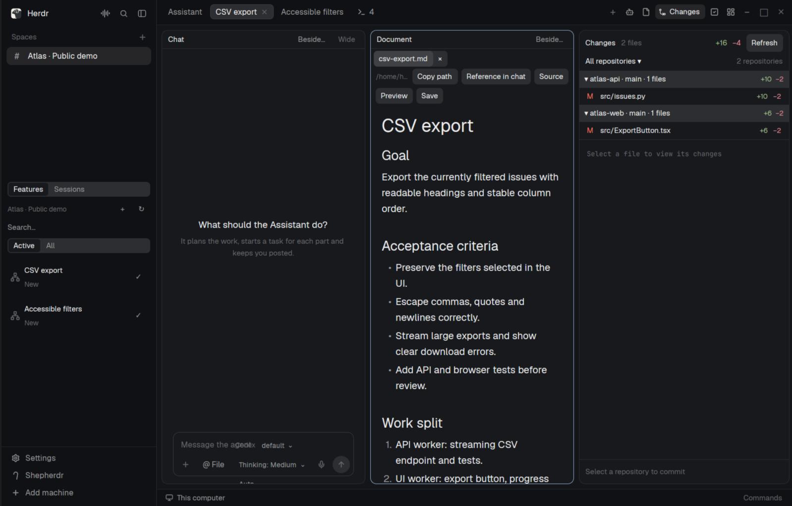

# Yurherdr

An IDE-style workspace for coding agents in Herdr App: conversations and terminals in the middle,
project files in separate panes, and independent Feature Assistants that turn each feature into
a plan, delegated worker tasks and review, while keeping the overall project conversation separate.
Yurherdr started as a fork of Elias Stravik's [Shepherdr](https://github.com/eliasstravik/shepherdr)
3.1.35 and grew into yurtools' personal development environment. It keeps that foundation's
orchestration, artifacts and optional web service, with explicit upstream credit and compatible
runtime IDs. This is a native App layout, not a Herdr TUI plugin.

## What you see

The theme supplies the dark canvas, raised cards, borders and accent colors. Use the person's
chosen theme rather than hard-coding a replacement. Read `layouts/shepherdr.json` for exact sizes.

- **Left sidebar:** Herdr's brand and Spaces, with **Features / Sessions** below them and a draggable
  divider. Features belong to the selected space and show combined Assistant/worker activity.
  Sessions shows saved local conversations and their original accounts. The foot opens Herdr's
  Settings, the workspace settings (legacy Shepherdr label) and Add machine.
- **Tab bar:** conversations, features and browser pages; + opens agents, Start feature, a terminal,
  the space Assistant, a browser URL or a configured chat shortcut. **Manage…** edits launchers.
- **Main workspace:** one or several panes with slim headers. Agent panes have Chat / Terminal,
  a width control and Beside. Keep model, thinking and permissions controls near the composer;
  the assigned account is shown, with its login kept separate from other profiles.
- **Files and document panes:** Files remains a project-rooted tree. A selected file opens in a
  separate pane with its own tabs, source/editor/preview controls, path actions and close buttons.
  Markdown renders as Markdown, CSV as a table, source in lexical colors. Office views show
  bounded read-only DOCX content and Excel OOXML sheets.
- **Right panel:** Agents, Changes, Tasks or Artifacts. Changes groups repositories under the space folder,
  showing changed repositories first, branches and per-file diffs; commits target one selected repository.
  Tasks opens a worker in place with a header, Chat / Terminal and available artifact, pull-request
  and browser views. Reports and previews stay
  close to the agent work rather than replacing the file tree.
- **Status and overlays:** machine/status strip, notifications and dialogs. Anchor dropdowns to the
  control pressed. Context menus offer normal clipboard actions where supported by the host.

## How it behaves

The daily workflow, in order of importance:

1. **Work with agents.** Switch the same process between Chat and Terminal. Collapse thinking/tool
   activity. Show an Assistant and workers beside each other without copying or restarting them.
2. **Give each feature its own lead.** Keep the space Assistant for project-wide discussion. Start a
   Feature Assistant from **+ → Start feature…**, or turn a reply into a feature with its flag action.
   For example, “CSV export” can coordinate API and UI workers while “Accessible filters” has its
   own conversation and tasks. Each Feature Assistant keeps its objective, account, conversation
   and owned tasks; worker results and delegated approval reviews return to that feature. Open
   features side by side, close their views and return later without losing the work. Configure
   the Feature Assistant separately while sharing Worker and Reviewer settings with the space
   Assistant. The Features list shows combined activity, including workers still running.
3. **Choose the intended account.** Configure named Codex profiles for space roles and named
   launchers for ordinary tabs. These are separate configurations targeting separately signed-in
   CLI homes. Preserve the assigned account through launch, resume, fork and restart, with its
   model/thinking/permissions and skill discovery; do not copy credentials.
4. **Inspect project files.** Root Files in the selected space. Keep its tree while documents open
   elsewhere. Edit source or switch Markdown/CSV preview modes. File paths, @ references and
   source links target the intended chat/document pane without auto-sending a message. Inspect changes
   across repositories, worktrees and submodules; select one repository to commit, retaining its own
   message draft. Discovery and previews are bounded; the web panel remains single-repository.
5. **Reduce repeated permission prompts while keeping control.** In Agents settings, choose a
   default for the space and overrides for Assistants, Features, Workers and Reviewers: **Ask me**,
   **Approved rules**, **Assistant review** or **Codex Auto-review**. Allow an action once, remember
   it for the task, or save an exact/“Starting with…” rule with a scope and expiry—for example,
   allow `git status` in this project without granting every Git operation. Rules stay bound to
   the account and working folder and can be revoked. With Assistant review, a feature's workers
   ask their owning Feature Assistant to evaluate the request. History shows who decided and why,
   and can create a rule for future requests. Agent **Permissions** still set its access/sandbox;
   giving the Assistant Full Access does not silently grant that access to its workers.
   See [approval modes and limits](docs/approvals.md).
6. **Resume work.** Sessions follows its space; a click resumes or focuses the exact conversation.
   Open… provides preview and Beside actions. Role-specific space instructions append to global
   prompts for fresh starts; existing/resumed contexts are retained.
7. **Use websites when needed.** Browser tabs remember URLs and isolated/shared profiles as configured.
   Web-chat pages use their own website account, not Codex's skills or credits. Keep a normal-browser
   fallback because automated/headless verification can fail.

Long conversations keep thinking and tool activity collapsible. Chat and document panes can be
resized without replacing the running agent or discarding its conversation.

## Current support and boundaries

- **Agent engines:** full Chat and the Space settings roles support Codex and Claude Code.
  This two-agent integration comes from the Shepherdr 3.1.35 foundation. The **+** menu can
  launch other installed CLIs in terminals, including Kimi and OpenCode; their full Chat and
  Assistant/Feature/Worker role adapters are not implemented. Registering a launcher does not
  add those integrations. In Space settings, engine selection is inside the model menu;
  named Codex accounts have an adjacent account dropdown.
- **Accounts and features:** named account profiles currently support Codex only. Features
  run in local spaces and retain their own conversations and tasks. Starting a feature does
  not automatically create a separate integration checkout; worker/task worktree settings
  control code isolation for parallel work.
- **Approval boundaries:** rules have account/folder/scope and expiry boundaries. Prefix rules
  apply to plain commands; scripts and complex actions need their own supported exact-action
  or once-only decision. Codex Auto-review requires a new or restarted agent. Its final native
  decision is not reported back as a known allow/deny in Yurherdr history. Autopilot scheduling
  is separate and remains attached to the space Assistant.
- **Native and web:** Feature, document and browser extensions are validated on native Linux;
  they do not imply full web or cross-platform parity. Native Changes supports multiple repos;
  web Changes remains single-repository. Office previews show bounded read-only content,
  without full page layout or formula recalculation. Discovery, file and preview limits are
  documented in [the workspace guide](docs/workspace.md).

## Built from

- **Layout:** `layouts/shepherdr.json`, retaining its IDs and key contexts for compatibility. Root
  splits `sidebar` and `work`; `work` contains the tab bar, active main tab, optional panel and status.
  Sidebar contains Spaces and the workspace Sessions/Features mod. Main panes use `pane-chat` headers.
- **Native mods:** the authoritative inventory is `lib/addons.json`. Workspace extensions include
  `chat`, `workspace-sessions`, `workspace-agents`, `workspace-files`, `workspace-document`,
  `workspace-changes`, `workspace-launchers`, file reference/search/actions, approvals and clipboard
  support. Shared modules come from `lib/` and `core/`, regenerated with `bin/sync-shared`.
- **Helpers:** `herdr-task`, `herdr-artifact`, `herdr-secret`, `herdr-browser` and the `shepherdr`
  installer. Role instructions are Assistant, Feature Assistant, Worker and Reviewer templates.
- **Optional web service:** Bun service plus built React web app, served on the person's tailnet.
  New native workspace extensions do not automatically have a matching web interface.
- **State:** existing `shepherdr` paths, services, module IDs, layout keys and browser profiles remain
  compatible. The public Yurherdr name does not migrate or duplicate a person's data.

## Dependencies and installation

Use the repository's `./install.sh`, not a copy of mods alone. The installer builds the web bundle,
backs up replaced files, merges keys and adds the required helpers and agent hooks. Start with
`./install.sh --dry-run`; preserve personal keys and edited role prompts. Then run `shepherdr doctor`
and select the **shepherdr** compatibility layout with Ctrl+Shift+L.

The inherited minimums are herdr-app 0.1.12, herdr-core 0.1.17, Python 3.8+, Git and an installed,
authenticated agent CLI. Current native validation used herdr-app 0.1.16 and herdr-core 0.1.21 on Linux.
Bun builds the service/web app; Node supports browser viewing. Tailscale, GitHub CLI and voice tools
are optional according to the enabled features. See [Install](docs/install.md).

The mods execute helper programs, inspect project files and agent logs, and may reach GitHub,
connected machines, websites or optional voice services through those programs. Review these
capabilities before installation. Keep the sandbox, approval and login boundaries of each agent.
DOCX/Excel previews do not promise full Office layout or formula recalculation.

## Done when

- The installer and `shepherdr doctor` report a whole installation; `bin/sync-shared --check` passes.
- Same-session Chat / Terminal, account controls and Beside work without replacing the agent.
- Independent features own the intended workers and show their current activity.
- Files stays a tree while documents open, edit, preview and close separately.
- Changes discovers sibling repositories, preserves file/repository identity and commits only the selected repo.
- Session resume retains the original account; space instructions append without editing globals.
- Approval history names its decision source and creates only future bounded rules.
- The worker's main conversation renders, including long messages, without picking an internal review log.
- Browser reconnects retain the page/profile and expose a normal-browser fallback when necessary.

## Attribution and maintenance

This is Yurherdr, maintained at [yurtools/shepherdr](https://github.com/yurtools/shepherdr),
derived from Shepherdr by Elias Stravik. Preserve the MIT copyright/permission notice, the
Herdr-related license and upstream history. There is no new Yurherdr release tag; 3.1.35 remains
the inherited runtime version. [Origins](docs/upstream.md) explains the branding and compatible names.
