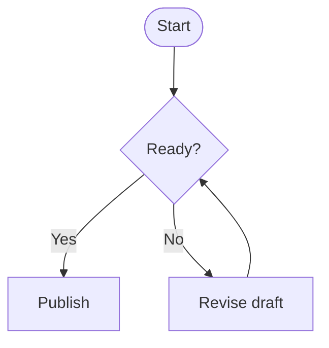

# Inline flowcharts in Chat

Both the person's messages and the agent's ordinary Markdown replies can contain
a fenced `mermaid` block:

````markdown

````

Chat draws the flowchart in place. **Show source** replaces the picture with
the original Mermaid text; **Show preview** restores it. **Copy** copies the
original source in either mode. Every supported picture has an **Expand
diagram** action above it. The inline overview fits the whole drawing into the
card (including wide and tall diagrams), and scrolling there continues to
scroll the conversation. Open the diagram to inspect smaller labels.

The separate viewer opens fitted to the available window. **Fit** restores the
whole overview; **100%**, **−** and **+** change label size. Use the four pan
buttons, scroll or drag (native), or scroll/swipe (web) to move across the
picture. The arrows and Page Up/Down move a viewport at a time; Home/End go to
the ends, `0` fits, `1` selects 100%, and `+`/`−` zoom. Copy in the viewer gets
the same original source. **Close** or Escape returns to the conversation.
In native Chat, Find (`Ctrl+F`) with a diagram's label or source selects that
historical diagram; `Ctrl+Enter` or the Find bar's **Expand** opens the match,
even when it is showing source. Ordinary code and message actions are unchanged.

## Syntax and boundaries

The same text-only subset of Mermaid runs in native Chat and the web app:

- `flowchart` or `graph` with directions `TD`, `TB`, `BT`, `LR`, `RL`
  (top-to-bottom by default).
- Nodes with bare identifiers or labels in brackets, parentheses, braces,
  stadiums, circles, subroutines, cylinders and hexagons. Quoted labels,
  `<br>` label breaks, and wrapped long labels are supported.
- Directed, undirected, bidirectional, dotted and thick edges, chained edges,
  loops, `-->|label|` and `-- label -->`, newline/semicolon-separated
  statements and plain `%%` comments.
- Top-level Markdown backtick or tilde fences, including longer matching
  fences. An unfinished fence shows its text and waits for the closing fence;
  it does not attempt layout.

This is not the complete Mermaid language. Subgraphs, classes, custom
styling, click/URL actions, configuration/front matter, arbitrary HTML, other
diagram types and syntax outside this subset remain copyable source with a
reason the preview is unavailable. A malformed graph does not show a partial
diagram. Native messages still awaiting delivery use the existing pending
message row until the log supplies the confirmed message.

The preview is bounded to 4,000 source characters, 20 nodes, 28 edges, 100
characters per label, 240 routed points, and a 3,600-unit drawing extent.
At most 12 diagrams are laid out per message; further fences show source.
Oversized source is shown up to 4,000 characters/120 lines with a note; Copy
still gets all of it. The inline drawing is at most 420 px high plus its
32 px Expand action. It has no independent scroll region. The expanded viewer
fits both axes, then allows readable actual size and zoom up to 250%; the
camera or browser scroll bounds keep each edge reachable without enlarging Chat.

## Implementation

`core/chat-fences.js` recognizes fences and keeps source separate from Markdown
and media extraction. `core/chat-flowchart.js` parses only the supported data
grammar, maps node IDs to internal numeric IDs and passes fixed, bounded graph
inputs to [Dagre](https://github.com/dagrejs/dagre) 1.1.5 (Graphlib 2.2.4).
The layout uses longest-path ranking and fixed initial ordering rather than
iterative crossing minimization.
The vendor file is the exact pinned upstream browser bundle with its MIT
license and a small ESM wrapper, allowing it to run without Node or a DOM in
the native mod. The package/lock and a test verify the bundled version and
license; to update it, replace the upstream distribution between
`const module = ...` and `export default module.exports` and keep the license
and version comment current. Then run `bin/sync-shared`.

There is no Mermaid runtime, external renderer, browser launch, arbitrary
SVG/HTML injection or evaluation of message text. Both surfaces use only
known shapes, numbers and literal labels from the shared geometry. The
web draws React SVG elements with CSS theme colors; the native mod uses
GPUI's `PathBuilder` and `window.paint_path` plus text and layout elements.
`core/chat-flowchart-geometry.js` owns the shared viewport sizing, camera and
control words. `lib/flowchart.js` owns the native drawing copied to `chat` and
`chat-flowchart`. The expanded native mod receives the already prepared drawing
and source, not a new layout job; the web reuses the same React SVG renderer.
The latter are available in Herdr App 0.1.16 / gpui-shell 0.7.1.

Native layout happens during cooperative history preparation, not a virtual
row's paint. Geometry from unchanged rows is reused across snapshots; the
shared source cache holds at most 96 entries and only plain data. Measurement
uses a height-only placeholder rather than constructing paths. Source switches
and Expand use the list's existing click routing; no per-row callbacks,
subprocesses, temporary graphics or retained native paths. The native expanded
modal has its own keyboard focus, bounded camera and input handlers, separate
from the virtual list. The web's single plugin overlay survives a phone/desktop
Chat reparent and uses native browser scrolling for the expanded view; it
returns focus to the original card or its reparented counterpart. Resize
observers, clipboard feedback timers and viewer state are discarded on close.
Both renderers use their current theme at paint time.

## Isolated checks

The ordinary repository checks include the shared grammar, source preservation,
media/fence handling, limits, geometry, native history preparation and click
routing, and the web's SVG/escaped fallback contract.

To exercise the actual native path/element materializer without starting
another Herdr App or installing any mod, use the synthetic fixture:

```sh
scratch=$(mktemp -d)
mkdir -p "$scratch/core/vendor"
cp test/fixtures/chat-flowchart-native.js "$scratch/main.js"
cp mods/chat/flowchart.js "$scratch/"
cp core/chat-flowchart.js core/chat-flowchart-geometry.js "$scratch/core/"
cp core/vendor/dagre.js "$scratch/core/vendor/"
printf '%s\n' '{"place":"none","title":"Synthetic flowchart fixture"}' > "$scratch/mod.json"
herdr-app check "$scratch" --print-spec
# Expanded viewer at the far end of a branching LR chart. Its scratch init
# deliberately avoids live keyboard ownership, conversations and overlays.
cp test/fixtures/chat-flowchart-expanded-native.js "$scratch/main.js"
cp mods/chat-flowchart/main.js "$scratch/viewer.js"
cp mods/chat-flowchart/keyholder.js "$scratch/"
herdr-app check "$scratch" --print-spec
```

The hidden check materializes eager elements but does not prove native paint,
deferred list layout, pointer interaction or macOS. Do not install the branch
in a live home or open another window just to obtain a screenshot.

For the real web Chat with synthetic messages only, build the branch and run
`bun test/fixtures/chat-flowchart-web.ts "$PWD/web/dist"` (loopback port
19444). Open `http://127.0.0.1:19444` in the task browser. The fixture serves
the built app and a minimal chat WebSocket, not the real service. The
`/fixture/complete` endpoint sends the closing fence for the incomplete
message, exercising the real update path. The browser regression program can drive an already-open task
browser at that URL (use its `get cdp-url` command to obtain the endpoint):

```sh
bun test/fixtures/chat-flowchart-browser.ts <cdp-url> http://127.0.0.1:19444
```

It checks the historical/multiple charts, fit, actual-size endpoints, real
emulated touch swipe, buttons and keyboard, resize/reparent, focus return,
source/copy, malformed/incomplete fences and ordinary code. Restart the stub
for each run so its streaming fixture begins incomplete. No live account, log
or data is used.

## SHEP-44 validation (original nested preview)

On Linux with Herdr App 0.1.16 and Bun 1.4.4, the final implementation passed
shared-copy, JavaScript, shell, JSON and TypeScript helper checks, TypeScript
typechecking and both Vite builds. The full guarded Bun run passed all 1,131
tests; Python discovery ran 876 tests with two skips and exited zero.
Scratch-root installer dry-run, install, doctor and uninstall passed. The
first sandboxed Bun run could not open its isolated loopback/Unix sockets;
the same suite passed on the guarded rerun without removing test isolation.

The native synthetic fixture passed the actual Herdr hidden check. The
production web build rendered the agent's branching flowchart and the user's
wide graph, retained ordinary fenced code, displayed malformed and incomplete
source, and changed the incomplete block into a diagram on the WebSocket
update. At 390 px width, an emulated touch swipe scrolled the graph to its
right edge without widening the page. Light/dark and desktop/phone resize
were inspected; switching source and pasting the Copy result into the
synthetic composer reproduced the original 123 characters exactly.

Native on-screen paint, native pointer scrolling/copy in an actual
conversation, macOS and physical phone hardware remain unverified. The
branch was not installed in the live window.

## SHEP-48 regression and live acceptance boundary

The installed SHEP-44 renderer matched the unchanged branch. A synthetic
13-step TD graph produced a 1,130 px canvas in a 420 px viewport; the equivalent
LR graph at 230 px available width produced a 1,452 px canvas. In the hidden
native spec the two axes were accessible only through nested `overflow_scrollbar`
inside deferred list rows, whose parent also tracks wheel input for following
and history loading. Raising the cap would neither make that route reliable nor
provide zoom. SHEP-48 removes the nested scroll surface rather than trying to
synchronize two independently scrolling lists. Hidden native materialization
and geometry/input tests are not evidence of on-screen paint or gestures.

A live trial of this candidate needs separate approval: use only the existing
Herdr window and one synthetic conversation in a test Chat, after the candidate
is made available through the normal install/update path. Reopen its saved
history; inspect a tall TD, wide LR and branching graph (including two diagrams
in one message) in narrow, wide and Comfortable Chat, and at non-default app
zoom. Click Expand, Fit and 100%, wheel/drag, pan all four ways and use keys to
reach the first/last nodes and edge labels. Resize/reparent while open, close
with Escape and Close, check the original scroll position and exact copy, and
scroll the surrounding conversation normally. Do not use another window or a
second live configuration. No native runtime rebuild or deployment is part of
SHEP-48.
